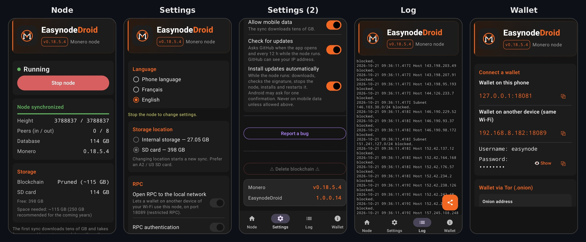

# EasynodeDroid Miner

<p align="center">
  
</p>

<p align="center">
  <b>Run your own Monero node on your Android phone — with built-in solo mining</b><br>
  <br>
  Pruned node · Built-in Tor  + onion address  · Verified monerod (SHA-256) · Self-updating .<br> 
  IP Bannlist . Blockchain on SDcard . Wallet ready . Multiling . Logs Tab . Mining
</p>

<p align="center">
  <a href="#features">Features</a> •
  <a href="#screenshots">Screenshots</a> •
  <a href="#requirements">Requirements</a> •
  <a href="#installation">Installation</a> •
  <a href="#usage">Usage</a> •
  <a href="#mining">Mining</a> •
  <a href="#connecting-a-wallet">Connect a wallet</a> •
  <a href="#tor">Tor</a> •
  <a href="#configuration">Configuration</a> •
  <a href="#troubleshooting">Troubleshooting</a> •
  <a href="#license">License</a>
</p>

<p align="center">
  <a href="https://github.com/kerlannXmr/EasynodeDroidMiner/releases/latest"><b>⬇ Download the latest APK</b></a>
</p>

---

> **EasynodeDroidMiner** is the version of [EasynodeDroid](https://github.com/kerlannXmr/EasynodeDroid) with a **Mining** tab.
> It is a separate app (`org.kerlann.easynode.miner`): it installs next to EasynodeDroid and has its own blockchain.
> Only one of the two nodes can run at a time (they use the same ports): stop one before starting the other.
> Both apps are signed with the same key and are published by the same author.

## Features

- **Monero node on your phone** – runs the official `monerod` directly on Android, no root, no PC needed.
- **Pruned blockchain** – about 115 GB instead of 250 GB, while still verifying every block.
- **Verified binary** – each release embeds the official `monerod` for Android ARM64, checked against the **GPG-signed** `hashes.txt` of the Monero Project (SHA-256) before the APK is built.
- **One-tap start / stop** – runs as a foreground service, with sync progress, height and peers in a notification.
- **Built-in Tor** – no Orbot needed. Gives your node a **.onion address** for your wallets and broadcasts your transactions over Tor.
- **Spy-node protection** – loads the community [IP ban list](https://github.com/Boog900/monero-ban-list) at every start.
- **Wallet-ready RPC** – local, local network (restricted RPC) or Tor, with optional login and password.
- **Internal storage or SD card** – choose where the blockchain lives.
- **In-app updates** – the app checks for new versions, verifies that the new APK is signed with the same key, stops the node cleanly, updates itself and restarts the node.
- **English / French** – follows the phone language or can be chosen in the app.
- **Solo mining** – a **Mining** tab uses the miner built into `monerod` (no extra program to download): choose your payout address and the number of cores, see the speed (H/s), blocks found and your estimated chance.
- **Phone-friendly mining** – light mode by default (about 256 MB of memory), optional **fast mode** on phones with 8 GB of memory or more, automatic pause on battery or when the phone gets too hot (60 °C).

---

## Screenshots

<p align="center">
  
</p>

---

## Requirements

### Device

| | |
|---|---|
| **Android** | 8.0 or newer |
| **Processor** | ARM64 (arm64-v8a), almost every phone since 2017 |
| **Storage** | ~115 GB free for the pruned blockchain, plus room to grow (256 GB SD card or more recommended) |
| **RAM** | 3 GB or more recommended (8 GB or more for the mining **fast mode**) |
| **Network** | Wi-Fi strongly recommended: the first sync downloads tens of GB |

The first synchronization takes from several hours to several days depending on the phone. Keep the phone **plugged in** and on **Wi-Fi**.

### Permissions

| Permission | Purpose |
|---|---|
| `INTERNET`, `ACCESS_NETWORK_STATE`, `ACCESS_WIFI_STATE` | Connect to the Monero network, detect Wi-Fi / mobile data |
| `FOREGROUND_SERVICE`, `FOREGROUND_SERVICE_SPECIAL_USE` | Keep the node running with a permanent notification |
| `WAKE_LOCK` | Keep the node working when the screen is off |
| `POST_NOTIFICATIONS` | Show sync progress and update notifications |
| `REQUEST_IGNORE_BATTERY_OPTIMIZATIONS` | Ask Android not to kill the node in the background |
| `REQUEST_INSTALL_PACKAGES` | Install EasynodeDroid Miner updates from inside the app |

---

## Installation

1. On your phone, open the **[latest release](https://github.com/kerlannXmr/EasynodeDroidMiner/releases/latest)** and download the `.apk` file.
2. Open it and allow installation from this source when Android asks.
3. If Play Protect warns about an unknown app, tap **More details › Install anyway** (the app is not distributed through the Play Store).

EasynodeDroid Miner installs **next to** EasynodeDroid (it does not replace it). The two apps keep their own blockchain and their own settings.

**Updates:** nothing to do. When a new version is published, the app shows **“New version available”** and can install it for you. Always install updates **over** the existing app: the blockchain is kept. Uninstalling the app deletes the blockchain (this is an Android rule).

---

## Usage

### First launch

1. Allow notifications.
2. In **Settings**, tap **Disable battery optimization** and accept.
3. Choose the storage location (internal storage or SD card).
4. Plug in the phone, connect to Wi-Fi, go to the **Node** tab and tap **Start node**.

### Running the node

The **Node** tab shows the status, sync progress, height, peers (in / out), database size and storage. The node keeps running when the app is closed; the notification shows its progress and has a **Stop** button.

The **Log** tab shows the live output of `monerod`.

### Stopping the node

Tap **Stop node** (in the app or in the notification). `monerod` is stopped cleanly so the database stays safe.

### Copying an existing blockchain

You can copy a blockchain from a PC instead of syncing from scratch:

1. Prune it on the PC first with `monero-blockchain-prune` (copying a full blockchain works, but the file stays ~230 GB on the card).
2. Copy `data.mdb` to `Android/data/org.kerlann.easynode.miner/files/bitmonero/lmdb/` on the SD card (card formatted as **exFAT**).

---

## Mining

The **Mining** tab uses the miner built into `monerod`. Nothing else is downloaded or installed.

### Start mining

1. Wait until the node is **synchronized** (the Node tab shows *Node synchronized*).
2. In **Mining settings**, paste the **main address** of your wallet: it starts with `4`. Subaddresses (starting with `8`) are refused by `monerod`.
3. Choose the number of cores.
4. Turn on **Solo mining**.

The tab then shows the speed (H/s), the cores used, the blocks found and the estimated time to find a block. The notification also shows the speed, and the **Log** tab shows when mining starts, stops or pauses.

Mining starts and stops on its own: it waits for the node to be synchronized, pauses when a condition is not met, and starts again after an app update or a node restart.

### Mining settings

| Setting | Description | Default |
|---|---|---|
| Solo mining | Turns mining on or off (needs a valid address) | Off |
| Fast mode | 5 to 10 times faster, but uses about 2.3 GB of memory. Only offered on phones with **8 GB of memory or more**. Restart the node to apply it | Off |
| Payout address | Main address of your wallet (starts with `4`) | – |
| Cores | Number of CPU cores used for mining | 1 |
| Only while charging | Pauses mining when the phone runs on battery | On |
| Pause if the phone gets hot | Pauses mining from 60 °C (battery temperature) or if Android reports a severe overheating, and resumes as soon as it cools down | On |

### Light mode and fast mode

- **Light mode (default)** uses about 256 MB of memory. It is slow (for example about 24 H/s on a Samsung Galaxy A05s with 1 core) but works on every phone.
- **Fast mode** uses about 2.3 GB of memory and needs about 30 seconds to prepare. On phones with less memory, Android closes the app, which is why it is only offered from 8 GB. If the app closes by itself, turn fast mode off.

### What can you expect?

Solo mining is a **lottery**: if your phone finds a block, the **whole reward (about 0.6 XMR)** goes to your address; otherwise you get nothing. There are no small regular payments.

With the Monero network at about 6 GH/s (October 2026):

| Speed | One block on average every… |
|---|---|
| 24 H/s (phone, light mode) | ~1,000 years |
| 200 H/s (phone, fast mode) | ~120 years |
| 23,000 H/s (powerful PC) | ~1 year |

Mining heats the phone, wears the battery and slows down the node. On a phone, see it as a fun way to take part in the Monero network, not as a source of income.

---

## Connecting a wallet

Works with Cake Wallet, Feather, Monerujo, Monero GUI and any wallet that accepts a remote node. The **Wallet** tab of the app shows the addresses to copy.

| Where is the wallet? | Address | Setting needed |
|---|---|---|
| On the same phone | `127.0.0.1:18081` | – |
| On another device, same Wi-Fi | `<phone IP>:18089` | **Open RPC to the local network** |
| Anywhere, through Tor | `<your address>.onion:18089` | **Tor** (and Tor enabled in the wallet) |

If **RPC authentication** is enabled, enter the same username and password in the wallet.

---

## Tor

Tor is **built into the app** (based on the Guardian Project's [tor-android](https://github.com/guardianproject/tor-android)); Orbot is not required.

When the **Tor** option is enabled:

- your node gets a permanent **.onion address**, shown in **Settings** and in the **Wallet** tab, with a copy button;
- wallets connect to it on port **18089** (restricted RPC: they can sync and send transactions, but not control the node);
- your own transactions are broadcast over Tor (`--tx-proxy`);
- to leave bandwidth to wallets using the .onion address, the node uses fewer peers (8 out / 8 in) and limits P2P upload to 512 kB/s.

Good to know: a .onion connection goes through 6 Tor relays, so it is naturally slower than a local connection. For best results, do the big initial wallet sync locally and use the .onion address for daily use.

---

## Configuration

### Settings

| Setting | Description | Default |
|---|---|---|
| Language | Phone language, Français or English | Phone language |
| Storage location | Internal storage or SD card | Internal storage |
| Open RPC to the local network | Lets other devices on your Wi-Fi use the node (restricted RPC) | Off |
| RPC authentication | Username / password required to use the RPC | Off |
| Block spy nodes | Loads the IP ban list at each start | On |
| Tor | .onion address + transactions via Tor | Off |
| Allow mobile data | Allow starting on a metered connection | Off |
| Check for updates | Ask GitHub for new versions | On |
| Install updates automatically | Update in the background while the node runs | On |

### Network ports

| Port | Purpose |
|---|---|
| `18080` | P2P (Monero network). Forward it on your router to accept incoming peers (usually impossible on mobile networks) |
| `18081` | Full RPC, on the phone only (`127.0.0.1`): the app and a wallet on the same phone |
| `18089` | Restricted RPC: other devices on your Wi-Fi (when enabled) and the .onion address |

---

## Troubleshooting

**The node won't start**
- Check the free space in the **Node** tab (~115 GB needed, 250 GB recommended).
- On mobile data the app refuses to start unless **Allow mobile data** is enabled.
- With Tor enabled, the node does not start if Tor cannot connect (by design, so your transactions are never sent without Tor). Check the connection or disable Tor.
- Look at the **Log** tab for the exact error.

**The node stops when the screen is off**
- Disable battery optimization in **Settings**, or in *Android Settings › Apps › EasynodeDroid Miner › Battery › Unrestricted*.

**The app closes when mining starts**
- Turn **Fast mode** off: the phone does not have enough free memory for it. Light mode works on every phone.

**Mining does not start**
- The node must be synchronized first, and the address must be a **main address** starting with `4`.
- With **Only while charging** on, plug the phone in. The status line in the Mining tab (and the Log tab) shows why mining is paused.

**Sync is slow**
- The first sync is long by nature. Keep the phone plugged in, on Wi-Fi, and prefer internal storage or a fast (A2 / U3) SD card.

**The wallet is slow through .onion**
- See the [Tor](#tor) section. Restarting the node makes Tor pick new relays.

---

## Security

- Full RPC listens on `127.0.0.1` only. Other devices (local network or .onion) only get **restricted RPC**, on port 18089.
- The .onion address only gives access to restricted RPC.
- The app holds **no wallet and no keys**: it only runs the node. For mining, it only needs your **public** address.
- `monerod` is the official binary, verified with the Monero Project's GPG signatures at build time.
- Updates are only installed if the new APK is signed with the same key as the installed app.

---

## Acknowledgments

- [The Monero Project](https://github.com/monero-project/monero) for `monerod`
- [Guardian Project](https://github.com/guardianproject/tor-android) for Tor on Android
- [Boog900](https://github.com/Boog900/monero-ban-list) for the IP ban list
- Adapted from the [EasyMonerod](https://github.com/kerlannXmr/easymonerod) Linux script

## Support the project

- ⭐ **Star** this repository
- **XMR donations** (Cake Wallet address): `kerlann.xmr`
- **XMR donations** (any wallet):
- 👇

```
88YbpCfGuA5Ez2qVNWEYHtc6qzFS4uLRaQ5iydCGoR2p3XVQfVkmmPDHjyw5tpDUnJCQL7QjdtxAS8nzC4x6VgH8Vs3Kjwk
```

---

## License

EasynodeDroid Miner is released under the [MIT License](LICENSE).

It bundles third-party software under their own licenses: `monerod` ([BSD-3-Clause](https://github.com/monero-project/monero/blob/master/LICENSE)) and Tor via tor-android ([BSD-3-Clause](https://github.com/guardianproject/tor-android/blob/master/LICENSE)).

## Disclaimer

This software is provided as is, without warranty. Running a node uses storage, data and battery. Mining heats the phone and wears the battery. You are responsible for how you use it.

<p align="center">Made with ❤️ for the Monero community</p>
